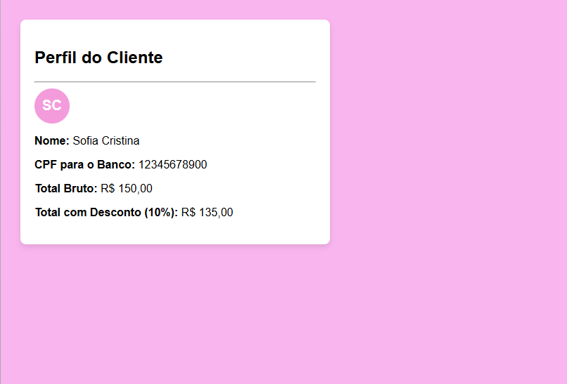

### Projeto 

Ao final de todos os códigos ficou assim:

# Respondendo as perguntinhas:
O require_once funcionou e a tela abriu sem erros, consegui também mudar a cor. O CPF foi impresso a limpo ficando exatamente 12345678900. O preço com desconto está correto? Sim, fica R$ 135,00.E o avatar exibe as iniciais ACS, a função gerarIniciais() retorna SC de Sofia Cristina 