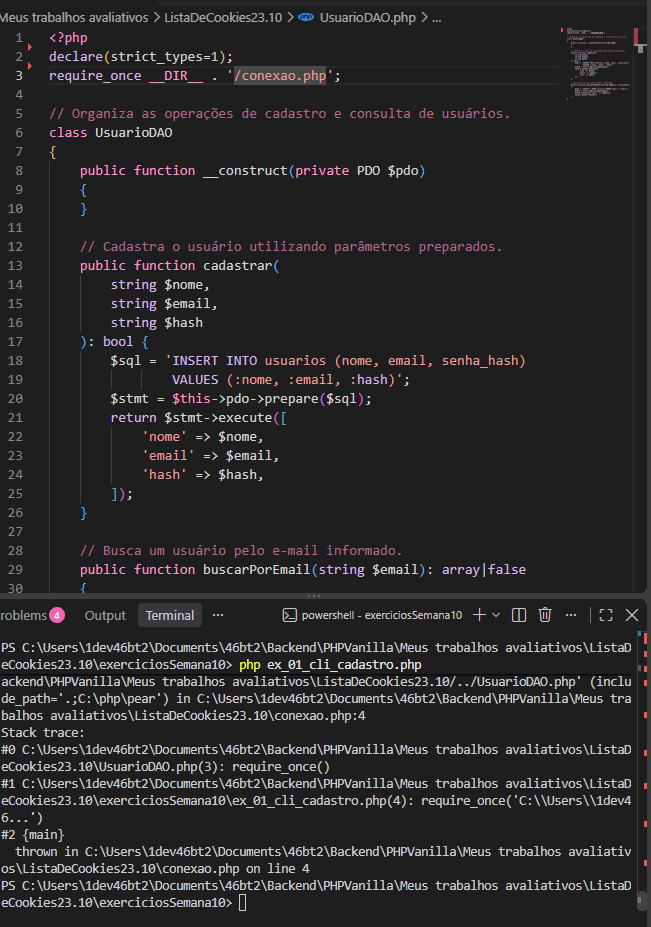

## Parte A Teórica ###

### 1. Protocolo Stateless
O HTTP é chamado de stateless porque cada requisição é independente. Por padrão, o servidor não lembra automaticamente quem fez a requisição anterior. Cookies e sessões permitem manter informações entre páginas, como o usuário que está conectado e suas permissões.
### 2. Cookies vs. sessões
Os cookies ficam armazenados no navegador do usuário e podem ser enviados ao servidor em novas requisições. Já os dados de $_SESSION ficam armazenados no servidor, sendo normalmente acessados por meio de um identificador de sessão enviado em um cookie.

As sessões são mais indicadas para informações confidenciais, pois os dados não precisam ficar expostos no navegador. Mesmo assim, é necessário proteger o identificador da sessão.

### 3. Flag HttpOnly
A opção HttpOnly => true impede que o JavaScript da página leia diretamente o cookie da sessão por meio de document.cookie. Isso reduz o risco de um ataque XSS roubar o identificador.

Ela não elimina o XSS nem impede todas as ações de um invasor: um script malicioso ainda pode tentar realizar requisições usando a sessão da vítima. Por isso, também são necessárias medidas contra XSS e CSRF.

### 4. Flag SameSite
O atributo SameSite=Lax limita o envio automático do cookie em requisições iniciadas em outros sites, especialmente em determinadas requisições entre sites. Ele ajuda a reduzir ataques de CSRF (Cross-Site Request Forgery), nos quais alguém tenta induzir um usuário conectado a realizar uma ação sem querer.

### 5. Session Fixation
É um ataque em que alguém tenta fazer a vítima utilizar um identificador de sessão conhecido pelo atacante. Após o login, session_regenerate_id(true) gera um novo identificador e invalida o anterior, reduzindo esse risco.

### 6. MD5 e Rainbow Tables
MD5 e SHA-256 são algoritmos rápidos e não são adequados (certos), sozinhos, para armazenar senhas. Essa rapidez facilita testar muitas combinações em pouco tempo. Rainbow Tables são tabelas pré-calculadas que relacionam hashes a possíveis valores originais, ajudando a descobrir senhas quando as condições permitem.

### 7. Salt
O salt é um valor aleatório adicionado ao processo de geração do hash da senha. Com salts diferentes, dois usuários que escolham a mesma senha normalmente terão hashes diferentes, dificultando o uso de tabelas pré-calculadas.

As funções password_hash() do PHP gerenciam esse processo automaticamente.

### 8. Argon2id vs. Bcrypt
Argon2id permite configurar o consumo de memória e o custo de processamento. O uso de memória dificulta a execução de muitas tentativas simultâneas em GPUs e circuitos especializados. Bcrypt continua sendo uma alternativa válida, mas Argon2id oferece controles adicionais de memória.

### 9. Timing Attacks
password_verify() é a função própria para conferir uma senha com um hash gerado por password_hash(). Ela trata o formato do hash e faz a comparação de forma apropriada para reduzir vazamentos por tempo de execução. Uma comparação simples com === não serve para validar senhas armazenadas nesse formato.

### A organização das pastas

ListaDeCookies

 readme.md
 conexao.php
 UsuarioDAO.php
 guard.php
 logout.php
 login.php
 relatorios_gerenciais.php

Exercicios:

 ex01_cli_cadastro.php

 ex02_inspetor_hash.php

 ex03_rbac_guard.php

 ex04_bloqueio_tentativas.php

 ex05_log_acessos.php

### Testando:

oii Diogo tdu bem ? Com está atividade eu estou tendo bastante dificuldade para rodar . Ele fica colocando erro na linha 4, que seria do caminho sendo que ele está correto 

 