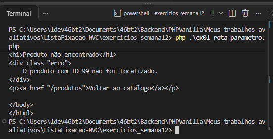
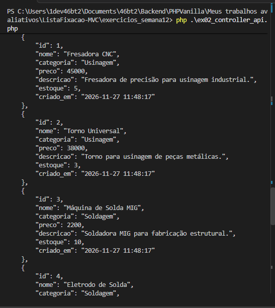

### Parte A

Questões Teóricas de Fixação:
## Parte A – Questões Teóricas de Fixação

**1. O Colapso do Código Espaguete**

Manter consultas SQL, regras de validação e códigos HTML no mesmo arquivo dificulta a organização e a manutenção do sistema, pois tudo fica  meio junto e misturado. Quando precisamos corrigir ou alterar alguma funcionalidade, podemos acabar afetando outras partes do projeto. Além disso, conforme o sistema cresce, o código fica mais difícil de entender, testar e atualizar. `Por isso, é importante separar as responsabilidades de cada parte`.

**2. A Tríade MVC**

O padrão MVC é dividido em `três partes: Model, View e Controller.` 
> O Model é responsável pelos dados, pelo acesso ao banco de dados e pelas regras de negócio.
> A View cuida da parte visual, ou seja, daquilo que aparece para o usuário.
> Já o Controller recebe as requisições, processa as informações e faz a comunicação entre o Model e a View. As regras de negócio devem ficar principalmente no Model.

**3. O Papel do Composer**

O arquivo composer.json informa quais bibliotecas e dependências o projeto precisa utilizar. Já o composer.lock registra as versões exatas dessas dependências instaladas, garantindo que o projeto funcione da mesma maneira em diferentes ambientes. A pasta vendor/ não deve ser enviada para o Git porque contém arquivos de bibliotecas instaladas pelo Composer, que podem ser baixadas novamente com o comando `composer install`.

**4. A Especificação PSR-4**

O Autoloader PSR-4 facilita o carregamento automático das classes do projeto, sem precisar utilizar vários comandos require ou include. Ele utiliza o namespace da classe para identificar o caminho do arquivo correspondente. Por exemplo, ao encontrar `App\Controllers\ProdutoController`, o Composer procura a classe dentro da pasta configurada para o namespace App, localizando o arquivo `src/Controllers/ProdutoController.php`.

**5. Front Controller**

O Front Controller centraliza todas as requisições do sistema em um único arquivo, geralmente o `public/index.php`. Sua principal vantagem de segurança é impedir que o usuário acesse diretamente arquivos internos do projeto, como configurações, classes e arquivos de conexão com o banco de dados. Dessa forma, somente os arquivos da pasta pública ficam disponíveis para acesso pela internet.

**6. Roteador HTTP**

O objeto Roteador diferencia as requisições verificando o método HTTP e o endereço solicitado. Por exemplo, uma requisição GET /produtos é utilizada para consultar ou listar produtos, enquanto uma requisição POST /produtos é utilizada para enviar informações e cadastrar um novo produto. Mesmo utilizando o mesmo endereço, cada método possui uma finalidade diferente.

**7. Injeção de Dados na View**

A função nativa `extract()` transforma os elementos de um array em variáveis PHP. No método renderizar() do Controller, ela permite que os dados enviados pelo Controller fiquem disponíveis diretamente dentro da View. Assim, conseguimos utilizar informações como nome, preço e descrição dos produtos na página, sem precisar acessar o array manualmente o tempo todo.

**8. Segurança contra XSS nas Views**

A função `htmlspecialchars()` é importante porque protege o sistema contra ataques XSS, que acontecem quando códigos maliciosos são inseridos em campos e exibidos nas páginas. Ela transforma caracteres especiais em entidades HTML, impedindo que determinados conteúdos sejam interpretados como códigos pelo navegador. Por isso, deve ser utilizada ao exibir dados dinâmicos em tabelas, formulários e outras partes da aplicação.

**9. Single Responsibility no Controller**

O Controller deve ter a responsabilidade de receber as requisições e organizar o fluxo entre o Model e a View. Ele não deve conter comandos SQL, conexões diretas com o banco de dados ou regras de negócio complexas, pois isso mistura responsabilidades e dificulta a manutenção. O ideal é deixar o acesso aos dados sob responsabilidade de classes específicas, mantendo o Controller mais organizado e simples.

**10. Transição para o Framework Laravel**

Os conceitos utilizados no MVC artesanal também estão presentes no Laravel 11. A separação entre Model, View e Controller, o roteamento HTTP, o autoload do Composer, o uso de namespaces, o Front Controller e a organização das responsabilidades continuam sendo utilizados. A principal diferença é que o Laravel já oferece ferramentas e estruturas prontas para facilitar o desenvolvimento, tornando o

### Testes:

#### Atividade 1. 

Ele rodou certinho eu só tive que mudar, porque ele não estava respondendo o erro numero 404, com o ` '/produtos/detalhe/3';` por isso eu usei `'/produtos/detalhe/99';` Só assim ele respondeu ao produto inexistente. 

#### Atividade 2 :

Retornou o código de status e o catálgo serializado em JSON 

> O resto das atividades também rodaraam como esparado 