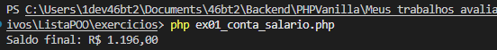
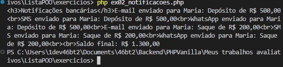
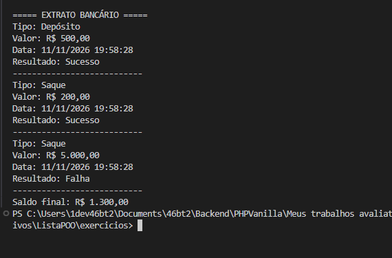
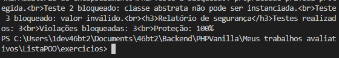
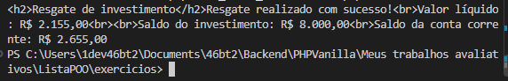

# Parte A 
## Questões Teóricas 

1. Procedural vs. OO

Manter regras financeiras em arrays e scripts procedurais apresenta três riscos principais: dificuldade de manutenção, falta de encapsulamento e maior possibilidade de erros que comprometam a segurança dos dados. A Programação Orientada a Objetos organiza as regras em classes e protege melhor as informações.

2. Ciclo de Vida do Objeto

Quando utilizamos new ContaCorrente(...), o PHP cria um objeto na memória Heap e reserva espaço para seus atributos. O método __construct() é executado automaticamente para inicializar o objeto com os valores necessários.

3. A Pseudo-Variável $this

O $this representa o próprio objeto que está sendo utilizado. Assim, $this->saldo acessa o atributo da classe, enquanto $saldo representa uma variável local, que existe apenas dentro daquele contexto.

4. Encapsulamento e Invariantes

Porque permitiria que qualquer parte do sistema alterasse o saldo livremente, inclusive colocando valores inválidos. O correto é manter o saldo como private e permitir alterações somente por métodos controlados, como depositar() e sacar().

5. Modificadores de Acesso

O private permite acesso somente dentro da própria classe. Já o protected permite acesso dentro da própria classe e também de suas subclasses, criadas por meio de extends.

6. Constructor Property Promotion

É um recurso do PHP 8 que permite declarar e inicializar atributos diretamente nos parâmetros do construtor. Isso reduz a repetição de código e deixa a classe mais organizada e fácil de entender.

7. Propriedades readonly

A palavra-chave readonly impede que uma propriedade receba um novo valor depois de sua inicialização. Isso ajuda a proteger informações que não devem ser alteradas, como um CPF ou CNPJ de identificação.

8. Classes Abstratas

A classe ContaBancaria deve ser abstrata porque representa um modelo geral de conta, que não deve ser instanciado diretamente. As classes ContaCorrente e ContaPoupanca herdam suas características e implementam suas próprias regras.

9. Polimorfismo

O método recebe qualquer objeto que pertença à classe ContaBancaria ou a uma de suas subclasses. Assim, ele consegue realizar transferências sem precisar verificar se a conta de destino é corrente, poupança ou outro tipo de conta.

10. Exceções de Domínio

Retornar false ou null pode dificultar a identificação do motivo pelo qual uma operação falhou. Com exceções personalizadas, como SaldoInsuficienteException, o sistema consegue identificar e tratar cada problema de maneira específica.

### Testando

#### Exercício 1:
O primeiro deu tudo certo:

considerando que 
- Saldo inicial: R$ 1.000,00
- Depósito de R$ 500,00: + R$ 500,00 = 1000
- Primeiro saque de R$ 100,00: − R$ 100,00
- Segundo saque de R$ 100,00: − R$ 100,00
- Terceiro saque de R$ 104,00: − R$ 104,00 (incluindo a taxa de R$ 4,00)

#### Exercício 2:
Deu certo 

#### Exercício 3:

#### Exercício 4:

#### Exercício 5:

Todos derão certo na hora de rodar a unica coisa é que no final eles ficaram vermelinhos com 2 há três eros, por isso eu fui na aba de problems no terminal, pra tentar corrigir por lá e descobri que era o . Eu fiz baseado nos ultímos projetos. 
